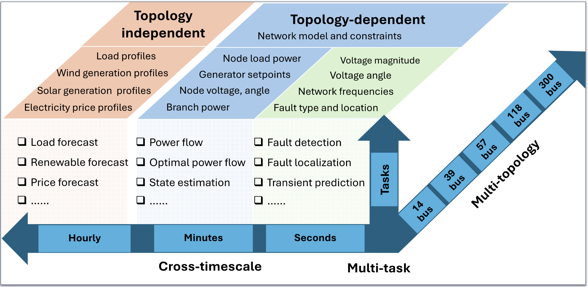
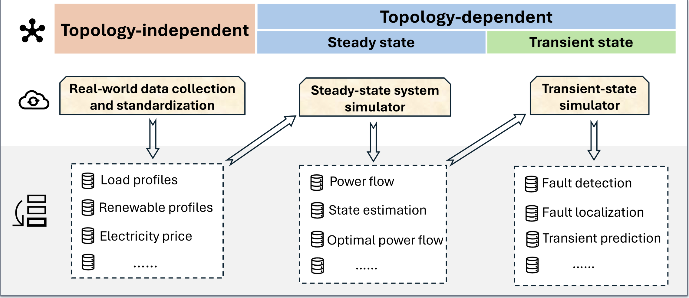
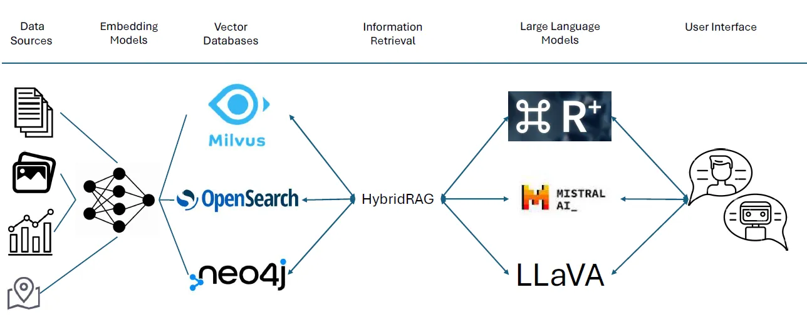

# PowerFM
PowerFM is an open-source repository for foundation models in the power and energy domain. It both maintains original projects and collects community-contributed open-source projects, featuring fine-tuned and domain-trained models for tasks like load forecasting, fault detection, grid simulation, and agent control.

## 🚀 Getting Started with PowerFM

### OpenPowerBench: Transformer-based Foundation Models

#### [Explore the Dataset and Benchmark for Power System Foundation Models Across Multiple Scales and Topologies](https://github.com/OpenPowerBench/OpenPowerBench)

**OpenPowerBench** is a first-of-its-kind open-source, multi-task, cross-temporal dataset designed to support training and evaluation of foundation models in power systems. OpenPowerBench includes both topology-dependent tasks (e.g., power flow, optimal power flow, contingency analysis) and topology-independent tasks (e.g., load forecasting, price prediction), supported by a modular data generation pipeline for scalable benchmarking across synthetic and real-world scenarios.

### GridSFM: Small Foundation Models for AC Optimal Power Flow

#### [Explore GridSFM: Open Code, Model Checkpoints, and Power-Grid Scenarios](https://github.com/microsoft/GridSFM)

**GridSFM** is a graph-based foundation model for approximating AC optimal power-flow (AC-OPF) solutions across different grid topologies. It predicts operating states—including bus voltages, generator dispatch, and branch power flows—and classifies solution feasibility. The open release includes the inference code and grid-scenario pipeline; pretrained checkpoints and datasets are available through the [Microsoft Hugging Face collection](https://huggingface.co/collections/microsoft/gridsfm). This is a useful addition for research on fast grid simulation, contingency screening, and planning. The repository is released under the MIT license.

### EnergyFM: Pretrained Foundation Models for Energy-Meter Analytics

#### [Explore EnergyFM Models, Tutorials, and Evaluation Leaderboard](https://github.com/energyfms/notebooks)

**EnergyFM** provides pretrained time-series foundation models for energy-meter data. Its **Energy-TTM** model targets short-term load forecasting, while **Energy-TSPulse** supports representation learning for anomaly detection and appliance classification. The repository includes zero-shot and fine-tuning notebooks, and a [public multi-task leaderboard](https://huggingface.co/spaces/EnergyFM/Leaderboard) for comparing models across energy analytics tasks. Pretrained models are available from the [EnergyFM Hugging Face collection](https://huggingface.co/EnergyFM). The repository uses the Apache-2.0 license.

### GridLDM: Language-Conditioned Latent Diffusion Models

#### [Explore GridLDM for Cross-Domain Power-System Time-Series Synthesis](https://github.com/cyuting940612/GridLDM)

**GridLDM** is a unified latent diffusion framework for controllable power-system time-series generation across heterogeneous domains, including EV charging, commercial load, wind generation, solar generation, and transient voltage response. GridLDM learns a shared latent generative prior and uses natural-language prompts with cross-attention to condition synthetic time-series generation across different data lengths, temporal structures, and operating contexts.

### GridFM: Graph Neural Network (GNN)-based Foundation Models

#### [Explore the Dataset and Graph for GridFM](https://github.com/gridfm)

**GridFM Community** The GridFM project pioneers the concept of FMs for the electric power grid to be trained on grid data – as opposed to text data – with the overarching goal to develop the underlying technology to cope with the increasing complexity and uncertainties of a faster growing grid (e.g., due to hyperscalar data centers, crypto mining etc.). More information about GridFM Community can be found [here](https://gridfm.org/)

### mAIEnergy: Multimodal Foundation Models for Energy

#### [Explore the mAIEnergy Dataset and Workflow](https://zenodo.org/records/16401633)

**mAIEnergy** is a unified, open-access multimodal corpus designed to support Continual Pre-Training (CPT) of Large Language Models (LLMs) and the development of Retrieval-Augmented Generation (RAG) systems in the energy domain. The dataset integrates heterogeneous energy-related information into structured, machine-readable formats, enabling seamless integration into modern AI and multimodal learning pipelines.

The corpus is organized into four top-level modules—textual, numerical, geospatial, and imagery—each accompanied by structured metadata and reproducible processing workflows. In total, the dataset contains approximately 50,000 textual documents, 20,000 images, 25 million numerical time-series records, and 2 million geospatial and relational data entries, primarily focusing on the European energy system.

Detailed datasets and fine-tuned models can be found below:
- **Dataset**: [Zenodo Repository](https://zenodo.org/records/16401633)
- **Trained/Fine-tuned Models**: [Hugging Face Model Hub](https://huggingface.co/ubitech-edg/models)

### RAG-based Foundation Models

#### [Explore the Datacenter Siting Assistant: Solvtra](https://huggingface.co/spaces/zhangqianleo/datacenterAgent)

**Datacenter Siting Assistant: Solvtra** is a tool leverages RAG by incorporating datacenter-specific data, including local regulations, environmental reports, and infrastructure details. As a result, it can provide detailed information for potential datacenter locations, such as land and electricity prices, and generate a map illustrating existing datacenter sites and relevant infrastructure.

## 🤝 Contributing

We welcome contributions! Please see our [Contributing Guidelines](https://power-agent.github.io/) for details.

## 📄 License

This project is licensed under the MIT License - see the [LICENSE](LICENSE) file for details.

## 🙏 Acknowledgments

### Core Team
[Shaohuai Liu](https://liushaohuai5.github.io/), [Yuting Cai](https://www.linkedin.com/in/yuting-cai/), [Alban Puech](https://www.alban-puech.fr/), 
[Costas Mylonas](https://www.linkedin.com/in/costas-mylonas-a0ab761b6/),
[Magda Foti](https://www.linkedin.com/in/magda-foti/),
[Qian Zhang](https://www.linkedin.com/in/qian-zhang-75323111b/) 

### Special Thanks
- All contributors who help make this project better
- [The Power and AI Initiative (PAI) at Harvard SEAS](https://pai.seas.harvard.edu/)
